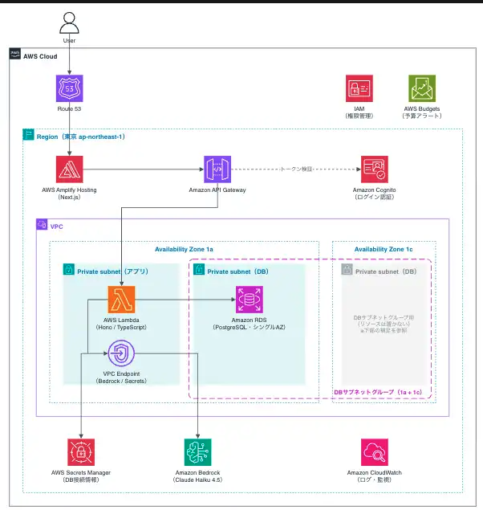

# アサーションCheck

AIを活用して、アサーティブ・コミュニケーションを練習するWebアプリケーションです。

ユーザーが日常生活や職場で困ったコミュニケーション場面と、その際に取った対応を入力すると、AIが対応の傾向を分析します。

分析結果をもとに、自分のコミュニケーションの特徴を振り返り、より適切な自己表現を身につけることを目的としています。

> **開発状況**
>
> 現在、ローカルMVPの主要機能を実装済みです。
> AWS本番環境へのデプロイおよび一部UI調整は今後実施予定です。

---

## 1. アプリ概要

### 開発目的

アサーティブ・コミュニケーションとは、自分の意見や気持ちを大切にしながら、相手の立場や考え方も尊重するコミュニケーション方法です。

本アプリでは、AIを活用して自身のコミュニケーションを客観的に振り返り、アサーティブな対応を練習できる環境を提供します。

### 想定ユーザー

- 職場や日常生活でのコミュニケーションに悩んでいる方
- 自分の意見や気持ちを適切に伝える練習をしたい方
- アサーティブ・コミュニケーションを学びたい方
- 過去のコミュニケーションを振り返り、改善につなげたい方

### アプリの基本的な流れ

1. ユーザー登録・ログイン
2. 困ったコミュニケーション場面を入力
3. その際に取った対応を入力
4. AIがコミュニケーションの傾向を分析
5. 分析結果・フィードバック・改善例を表示
6. 分析履歴を保存し、後から振り返る

---

## 2. 機能一覧

### MVP機能

| 機能 | 概要 | 実装状況 |
|---|---|---|
| ユーザー登録 | メールアドレス・ユーザー名を使用した新規登録 | ✅ |
| メール認証 | Cognitoによるメールアドレス確認 | ✅ |
| ログイン・ログアウト | Cognitoによるユーザー認証 | ✅ |
| アサーション分析 | 入力内容をAmazon Bedrockで分析 | ✅ |
| コミュニケーションタイプの数値化 | 3種類のコミュニケーション傾向を割合で表示 | ✅ |
| フィードバック | AIによる対応内容の評価 | ✅ |
| 改善例の提示 | よりアサーティブな対応例を提示 | ✅ |
| 分析結果の保存 | PostgreSQLへの分析内容・結果の保存 | ✅ |
| 分析履歴一覧 | 過去の分析履歴を一覧表示 | ✅ |
| 分析履歴詳細 | 保存済みの分析内容・結果を表示 | ✅ |
| マイページ | ユーザー情報の表示 | ✅ |
| アサーションの説明 | アサーションやコミュニケーションタイプを説明 | ✅ |

### 3つのコミュニケーションタイプ

AIは、入力された対応を以下の3つの観点から分析します。

| タイプ | 説明 |
|---|---|
| アサーティブ | 自分と相手の両方を尊重する自己表現 |
| アグレッシブ | 自分の意見を優先し、相手への配慮が不足しやすい自己表現 |
| ノンアサーティブ | 相手を優先し、自分の意見や気持ちを抑えやすい自己表現 |

各タイプの割合を合計100%で表示します。

また、数値だけでなく、フィードバックと改善例を提示します。

### 追加機能（実装予定）

今後、利用状況やレビュー結果を踏まえて機能を追加する予定です。

候補として、以下を検討しています。

- 分析履歴の検索・絞り込み
- 分析履歴の編集・削除
- 分析結果の推移を可視化
- ユーザー情報の編集
- ゲストログイン
- UI・UXの改善

### 公開に向けた対応

- 利用規約の整備
- プライバシーポリシーの整備


※追加機能は現時点での検討案であり、実装内容は変更する可能性があります。

---

## 3. 技術スタック

### フロントエンド

| 技術 | 用途 |
|---|---|
| Next.js 16（App Router） | フロントエンドフレームワーク |
| React | UI構築 |
| TypeScript | 型安全な開発 |
| Tailwind CSS 4 | スタイリング |
| AWS Amplify Auth | Cognitoとの認証連携 |

### バックエンド

| 技術 | 用途 |
|---|---|
| Hono 4 | API開発 |
| TypeScript | バックエンド開発 |
| Zod | リクエスト・レスポンスのバリデーション |
| Drizzle ORM | データベース操作 |
| Drizzle Kit | マイグレーション管理 |
| AWS SDK for JavaScript v3 | Amazon Bedrockとの連携 |
| aws-jwt-verify | CognitoのJWT検証 |

### データベース・開発環境

| 技術 | 用途 |
|---|---|
| PostgreSQL | ユーザー情報・分析履歴の保存 |
| Docker | ローカルDB環境 |
| Node.js 24 | JavaScript実行環境 |
| npm | パッケージ管理 |
| Git / GitHub | ソースコード管理 |
| GitHub Actions | CI |

### AWSサービス

| サービス | 用途 |
|---|---|
| AWS Amplify Hosting | Next.jsのホスティング |
| Amazon API Gateway | フロントエンドからのAPIリクエスト受付 |
| AWS Lambda | Hono / TypeScriptの実行 |
| Amazon RDS for PostgreSQL | ユーザー情報・分析履歴の保存 |
| Amazon Cognito | ユーザー認証・JWTの発行 |
| Amazon Bedrock | Claude Haiku 4.5によるAI分析 |
| Amazon Route 53 | DNS・ドメイン管理 |
| Amazon VPC | AWSリソースのネットワーク管理 |
| VPC Endpoint | VPC内からBedrock・Secrets Managerへの接続 |
| AWS Secrets Manager | DB接続情報などの機密情報管理 |
| Amazon CloudWatch | ログ・監視 |
| AWS IAM | AWSサービスへのアクセス権限管理 |
| AWS Budgets | コスト管理・予算アラート |

---

## 4. システム構成

### ローカル開発環境

現在は、フロントエンドとバックエンドをローカルで起動しています。

データベースにはDocker上のPostgreSQLを使用し、認証と生成AIにはAWSのマネージドサービスを利用しています。

```text
                  ユーザー
                     |
                     v
             Next.js（ローカル）
                     |
                     v
               Hono API
                     |
          +----------+----------+
          |          |          |
          v          v          v
      Cognito     Bedrock   PostgreSQL
       (AWS)       (AWS)     (Docker)
```

※実際にはCognitoによる認証をフロントエンドから実行し、バックエンドではJWTを検証します。

### 本番環境（予定）

本番環境ではAWSを中心とした構成を予定しています。

| 役割 | AWSサービス |
|---|---|
| フロントエンド | AWS Amplify Hosting |
| API | Amazon API Gateway |
| バックエンド | AWS Lambda |
| データベース | Amazon RDS for PostgreSQL |
| 生成AI | Amazon Bedrock |
| 認証 | Amazon Cognito |

### ネットワーク構成

本番環境では、東京リージョン（ap-northeast-1）にVPCを構築する予定です。

LambdaとRDSをプライベートサブネットに配置し、RDSはシングルAZ構成を採用する予定です。

また、LambdaからBedrockやSecrets Managerへのアクセスには、VPC Endpointを利用する構成を想定しています。

### AWSアーキテクチャ図

<!-- 作成済みのAWSアーキテクチャ図を挿入 -->



---

## 5. データベース設計

データベースにはPostgreSQLを採用しています。

Drizzle ORMを使用してテーブル定義とデータベース操作を管理しています。

### ER図

<!-- 作成済みのER図を挿入 -->


### テーブル一覧

| テーブル名 | 用途 |
|---|---|
| users | ユーザー情報の管理 |
| records | ユーザーが入力した分析内容の保存 |
| analysis_results | AIによる分析結果の保存 |

### users

ユーザー情報を管理するテーブルです。

| カラム | 説明 |
|---|---|
| id | ユーザーID |
| cognito_sub | Cognitoのユーザー識別子 |
| username | ユーザー名 |
| created_at | 作成日時 |
| updated_at | 更新日時 |

Cognitoのユーザー識別子とDB上のユーザー情報を紐付けています。

### records

ユーザーが入力した分析内容を保存するテーブルです。

| カラム | 説明 |
|---|---|
| id | レコードID |
| user_id | ユーザーID |
| situation | 困った場面 |
| response | 取った対応 |
| created_at | 作成日時 |
| updated_at | 更新日時 |

### analysis_results

AIが生成した分析結果を保存するテーブルです。

| カラム | 説明 |
|---|---|
| id | 分析結果ID |
| record_id | 対応するレコードID |
| assertive_score | アサーティブ割合 |
| aggressive_score | アグレッシブ割合 |
| non_assertive_score | ノンアサーティブ割合 |
| feedback | AIによるフィードバック |
| improvement | 改善例 |
| created_at | 作成日時 |

### テーブル間の関連

```text
users
  |
  | 1対多
  v
records
  |
  | 1対1
  v
analysis_results
```

1人のユーザーが複数の分析履歴を持ち、1つの分析履歴に対して1つの分析結果が紐付きます。

---

## 6. ディレクトリ構成

フロントエンドとバックエンドを1つのリポジトリで管理するモノレポ構成を採用しています。

```text
Assertion_Check/
│
├── .github/
│   └── workflows/
│       └── ci.yml             # GitHub Actions
│
├── frontend/                  # Next.js
│   └── src/
│       ├── app/               # 画面・ルーティング
│       ├── components/        # UIコンポーネント
│       ├── lib/               # 共通処理
│       └── types/             # 型定義
│
├── backend/                   # Hono
│   ├── drizzle/               # マイグレーションファイル
│   ├── drizzle.config.ts      # Drizzle Kitの設定
│   └── src/
│       ├── routes/            # APIルート
│       ├── services/          # ビジネスロジック
│       ├── middleware/        # 認証などの共通処理
│       ├── db/                # DB接続・スキーマ
│       └── schemas/           # バリデーション
│
├── docs/
│   └── images/                # AWS構成図・ER図
│
├── compose.yaml               # Docker Composeの設定
├── .nvmrc                     # Node.jsのバージョン
├── .gitignore
└── README.md
```

---

## 7. ローカル環境構築

### 7-1. 前提条件

以下の環境が必要です。

| 項目 | 内容 |
|---|---|
| Node.js | 24（`.nvmrc` で指定） |
| npm | パッケージ管理 |
| Docker / Docker Compose | ローカルPostgreSQLの起動 |
| AWSアカウント | Cognito・Bedrockの利用 |
| Amazon Cognito | ユーザー認証の設定 |
| Amazon Bedrock | Claude Haiku 4.5の利用権限 |

※ CognitoとBedrockはAWS上のサービスを利用するため、ローカル環境でもAWS側の設定が必要です。

### 7-2. リポジトリのクローン

```bash
git clone <リポジトリURL>
cd Assertion_Check
```

### 7-3. Node.jsのバージョン設定

本プロジェクトではNode.js 24を使用しています。

nvmを利用している場合、プロジェクトのルートディレクトリで以下を実行してください。

```bash
nvm install
nvm use
```

`.nvmrc` に記載されたNode.jsのバージョンが使用されます。

### 7-4. パッケージのインストール

フロントエンドとバックエンドで、それぞれ依存パッケージをインストールします。

**フロントエンド**

```bash
cd frontend
npm ci
cd ..
```

**バックエンド**

```bash
cd backend
npm ci
cd ..
```

`npm ci` は、`package-lock.json` に基づいて依存パッケージをインストールするコマンドです。

### 7-5. 環境変数の設定

フロントエンドとバックエンドで、それぞれ環境変数を設定します。

| 設定ファイル | 用途 |
|---|---|
| `frontend/.env.local` | Cognitoの設定・API接続先など |
| `backend/.env` | DB接続情報・AWS関連の設定など |

#### データベース接続設定

バックエンドでは、`backend/.env` にPostgreSQLの接続情報を設定します。

```env
DATABASE_URL=postgresql://<DB_USER>:<DB_PASSWORD>@127.0.0.1:5432/<DB_NAME>
```

※ 上記はローカル開発用の設定例です。実際の設定値はDocker Composeの設定と一致させてください。

#### AWS関連の環境変数

本アプリでは、以下のAWSサービスを利用しています。

- Amazon Cognito：ユーザー認証
- Amazon Bedrock：AIによるアサーション分析

AWS環境は開発者が個別に管理しているため、認証情報や具体的な設定値は公開していません。

#### 注意事項

- `.env` および `.env.local` はGit管理対象外としています。
- AWSアクセスキーなどの認証情報はGitHubに公開していません。
- Cognito・Bedrockを利用するには、AWS側の設定と適切な権限が必要です。

### 7-6. PostgreSQLの起動

ローカル開発では、Docker Composeを使用してPostgreSQL 17を起動します。

プロジェクトのルートディレクトリで実行してください。

```bash
docker compose up -d
```

**起動状態の確認**

```bash
docker compose ps
```

**PostgreSQLへの接続**

```bash
docker compose exec postgres psql -U assertion_user -d assertion_check
```

**テーブル一覧の確認**

PostgreSQLに接続した状態で実行します。

```sql
\dt
```

**ユーザー情報の確認**

```sql
SELECT id, username, created_at
FROM users;
```

**PostgreSQLから切断**

```text
\q
```

**PostgreSQLの停止**

```bash
docker compose down
```

※ `docker compose down` では、通常、永続化されたDBデータは削除されません。

※ `docker compose down -v` はボリュームも削除するため、DBデータを消したくない場合は実行しないでください。

### 7-7. Drizzle ORMのマイグレーション

データベース操作にはDrizzle ORMを使用し、マイグレーションはDrizzle Kitで管理しています。

以下のコマンドは、`backend` ディレクトリで実行してください。

**マイグレーションファイルの生成**

`schema.ts` を変更した場合に実行します。

```bash
npx drizzle-kit generate
```

**マイグレーションの適用**

```bash
npx drizzle-kit migrate
```

**マイグレーションの確認**

```bash
npx drizzle-kit check
```

※ 初回セットアップでは、リポジトリに含まれるマイグレーションファイルを適用するため、基本的には `migrate` を実行します。

### 7-8. バックエンドの起動

`backend` ディレクトリで実行します。

```bash
cd backend
npm run dev
```

バックエンドは以下のURLで起動します。

```text
http://localhost:8787
```

**ヘルスチェック**

別のターミナルで以下を実行します。

```bash
curl http://localhost:8787/health
```

正常な場合：

```json
{
  "status": "ok"
}
```

### 7-9. フロントエンドの起動

別のターミナルを開き、`frontend` ディレクトリで実行します。

```bash
cd frontend
npm run dev
```

ブラウザで以下にアクセスしてください。

```text
http://localhost:3000
```

### 7-10. 開発用コマンド

#### フロントエンド

`frontend` ディレクトリで実行します。

| コマンド | 内容 |
|---|---|
| `npm run dev` | 開発サーバー起動 |
| `npm run lint` | ESLintによるコードチェック |
| `npm run type-check` | TypeScriptの型チェック |
| `npm run build` | 本番ビルド |

#### バックエンド

`backend` ディレクトリで実行します。

| コマンド | 内容 |
|---|---|
| `npm run dev` | 開発サーバー起動（ホットリロード） |
| `npm run lint` | ESLintによるコードチェック |
| `npm run type-check` | TypeScriptの型チェック |
| `npm run build` | Lambda用にバンドル（`dist/lambda.mjs`、ハンドラー名 `handler`） |

### 7-11. CI（継続的インテグレーション）

GitHub Actionsを使用して、コードの品質チェックを自動化しています。

設定ファイル：

```text
.github/workflows/ci.yml
```

`main` ブランチへのpushおよびPull Request時に、フロントエンド・バックエンドそれぞれで以下を実行します。

```text
npm ci
   ↓
lint
   ↓
type-check
   ↓
build
```

これにより、依存パッケージの不足・Lintエラー・型エラー・ビルドエラーなどを検出します。

※ CIではAWSサービスへの実接続を行わず、ビルドに必要な環境変数にはダミー値を使用しています。

---

## 8. 開発状況・今後の予定

### 現在の開発状況

ローカルMVPの主要機能を実装済みです。

- [x] 開発環境の構築
- [x] Amazon Bedrockとの連携
- [x] アサーション分析API
- [x] 新規分析画面
- [x] 分析結果画面
- [x] Cognitoによるユーザー認証
- [x] PostgreSQLへのデータ保存
- [x] 分析履歴一覧・詳細
- [x] マイページ
- [x] アサーションの説明機能
- [x] 分析結果画面の統合

### 今後の予定

- [ ] UI設計書に合わせたレイアウト調整
- [ ] AWS本番環境の構築
- [ ] 本番環境へのデプロイ
- [ ] 追加機能の検討・実装

---

## 9. 参考資料
- [画面遷移図](https://claude.ai/artifact/NjiBnrcPJJYuhn4GPnPXVw)
- [UI設計書](https://claude.ai/artifact/LZGCTSUBgKM8sQnBJmMtmu)